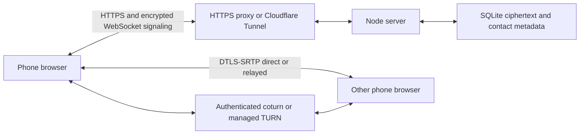

# Architecture and source map

## Source files

| File/directory | Responsibility |
|---|---|
| public/index.html, style.css, icon.svg | Responsive conversation UI, dialogs, call controls and local SVG assets |
| public/message-actions.js, message-state.js, messages.css | Message actions, encrypted state validation, receipts/reactions/reply/pin rendering and automatic theme |
| server/message-events.mjs | Authenticated encrypted state batches, bounded state history, parent expiry and WebSocket propagation |
| public/chat-ui.js | Keyed message rendering, media bubbles and searchable Unicode emoji picker |
| public/chat-capture.js | Separate camera/voice capture, cleanup and voice-note codec selection |
| public/app.js | Enrollment, contact pins, encrypted chat/signaling, call state, ringing, notifications, timers and reconnect |
| public/crypto.js | Key generation, non-exportable vault, fingerprint/safety number, signed encryption and verification |
| public/attachments.js | Per-file keys, validated manifests, indexed chunk encryption/decryption and size limits |
| server/attachments.mjs | Authenticated chunk upload/download, pending transfer cleanup and storage quotas |
| public/onboarding.js | Parse invite/setup fragments, invitation precedence and removing secrets from the address |
| public/media-cache.js | Identity-scoped encrypted IndexedDB media retention, expiry and transactional deletion tombstones |
| public/call-metrics.js | Separate voice/video RTP rates, bundled totals and active codec labels |
| public/video-codecs.js | Bounded WebRTC encode/decode efficiency probes and mutual codec variant preferences |
| public/transfer-policy.js | Call-health checks, 4 KB piece size and paced voice-first transfers |
| public/media.js | Phone class, Opus SDP tuning, capture, sender adaptation, candidate queues, ICE restart and relay test |
| public/call-intents.js | Atomic one-use notification answer decision store, scoped to device/call with a 30-second validity limit |
| public/sw.js | Call-state checks, generic notifications, foreground-ring coordination, notification actions and taps; no fetch cache |
| public/call-setup.js | Phone detection, Home Screen guidance, notification permission and heard-alert verification |
| public/manifest.webmanifest | Stable web app identity/scope, Home Screen display and icons; document URL is the launch fallback |
| server/call-alerts.mjs | Bounded cancellable reminder scheduler and declarative push payloads |
| server/index.mjs | HTTP/API/auth, ciphertext mailbox, contact-authorized WebSocket routing, push and TURN credentials |
| server/store.mjs | SQLite schema, transactions, secure deletion, expiry and storage helpers |
| scripts/setup.mjs | Generate missing private secrets while preserving existing values |
| scripts/phone-setup-qr.py | Private loopback or explicit terminal QR; reads a local .env or remote SSH configuration |
| scripts/network-check.py, relay-probe.mjs, verify-public.mjs | Network evidence, authenticated UDP relay allocation, HTTPS/header/WebSocket verification |
| scripts/browser-qa.mjs, invite-qa.mjs, ui-peer.mjs | Local-only disposable synthetic media/enrollment/messaging harnesses |
| scripts/router-turn.py | Optional explicit UPnP mapping status/apply/removal with collision checks |
| scripts/configure-local-turn.mjs, turn-maintenance.mjs | Advanced native config, public-IP/mapping/certificate maintenance |
| deploy/ | Guided Debian/Compose deployment, Caddy, coturn, native examples and optional existing-origin proxy |
| tests/ | Encryption, backend authorization/expiry, media policy/restart and fragment security regression tests |

## API routes below /calls/api

| Method / route | Function |
|---|---|
| GET /config | Public base URL, first-registration availability, public push key and relay availability |
| POST /register | First browser, using private owner code and browser public keys |
| POST /join | Redeem single-use invitation; create/reuse device and connect contacts |
| GET /me | Authenticated self/contact metadata |
| DELETE /contacts/:id | Idempotently remove the mutual contact relationship and shared history/media; end this pair’s call; return contact list and deleted IDs |
| POST /invite | Create one-person invitation, with optional recipient name |
| POST /invite-info | Verify invitation/fingerprint and preview names without redemption (unauthenticated) |
| GET /ice | Authenticated STUN/TURN config with temporary credentials |
| POST /ticket | Short-lived single-use WebSocket authentication ticket |
| GET /message-events | Latest encrypted states for the same 500 live messages returned by the mailbox |
| POST /message-events | Up to 20 encrypted updates per atomic batch; sender-only edit, recipient-only delivery/read, participant reactions/pins |
| GET /messages | Authorized unexpired ciphertext mailbox |
| POST /messages | Validate/store idempotent signed ciphertext and notify recipient |
| GET /message-deletions | Participant-scoped deletion markers until original message expiry |
| DELETE /messages/:id | Either participant removes a message and its attachment; emits deletion to both |
| POST /attachments | Reserve an expiring encrypted transfer with its exact message envelope |
| PUT /attachments/:id/chunks/:part | Sender-only upload of a bounded encrypted chunk |
| GET /attachments/:id/chunks/:part | Sender/recipient download after all chunks are committed |
| DELETE /attachments/:id | Sender-only cancellation of an unfinished transfer |
| POST/DELETE /push | Register/remove provider-restricted push subscription |
| POST /push/status | Current subscription’s registration and user-confirmed test state |
| POST /push/test | Send a delayed test to the authenticated owner’s selected subscription |
| POST /push/test-result | Confirm a sent, unexpired test after the user reports hearing it |
| POST /calls/:id/decline | Recipient-only dismissal of waiting calls from notification actions; origin/auth enforced, cannot end answered calls |
| GET /calls/:id | Participant-only ringing/answered/ended status for stale-alert suppression |
| DELETE /device | Delete device-related records, close sockets and notify contacts |

`/calls/health` is a simple health endpoint. `/calls/ws` upgrades with an allowed Origin; its first frame consumes the ticket. Encrypted call frames carry call IDs/kinds and sealed offers/answers/ICE. Offers to an offline recipient are held in RAM for 90 seconds; server restarts discard them. SQLite attachment tables are created additively on startup. Chunk blobs reference their manifest with cascading deletion. The original message tables are retained. Message envelope fields include version, IDs, sender/recipient, creation/expiry, ephemeral public key, nonce, ciphertext copies and signature. Browser tokens/keys are never embedded in server logs by the app.

The optional `archive-proxy.mjs` bypasses an existing Node site's visitor handler for only /calls and upgrades, strips its cookies and forwards to loopback. `link-archive.mjs` recognizes a specific http.createServer wrapper and backs it up before adding hooks; it is not a universal website installer. Use a normal reverse proxy for unrelated frameworks.

Typing uses authenticated WebSocket `{type:"typing", envelope}` events with signed encrypted payloads `{kind:"typing",active:boolean}` and an eight-second client TTL. It does not enter the call map/mailbox or offline replay. Deletion uses authenticated HTTP and metadata notifications; clients reject delayed envelopes for known deleted IDs.

File activity uses signed encrypted `sharing` signals inside an existing participant-bound call. It is not stored in the mailbox or replayed; the receiving lease expires after 30 seconds. Local transfer completion/abort immediately restores the local current video budget. Notification decisions never come from URLs, socket offers or push arrivals; only worker notification-button clicks create them.
