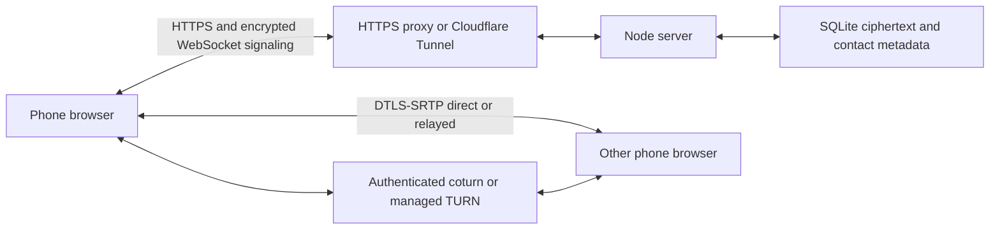

# Architecture and source map

## Source files

| File/directory | Responsibility |
|---|---|
| public/index.html, style.css, icon.svg | Responsive conversation UI, dialogs, call controls and local SVG assets |
| public/message-actions.js, message-state.js, messages.css | Message actions, encrypted state validation, receipts/reactions/reply/pin rendering and automatic theme |
| server/message-events.mjs | Authenticated encrypted state batches, bounded state history, parent expiry and WebSocket propagation |
| public/chat-ui.js | Keyed message rendering, media bubbles and searchable Unicode emoji picker |
| public/chat-capture.js | Separate camera/voice capture, cleanup and voice-note codec selection |
| public/app.js | Enrollment, contact pins, encrypted chat/signaling, call state, ringing, notifications, timers and reconnect |
| public/dial-code.js, dialing.js | Public numeric addresses, saved-identity enrollment retries, keypad, code settings and request controls |
| server/dialing.mjs | Opt-in code reservation, bounded guest enrollment, pending requests, acceptance and identity blocking |
| public/theme.js, contact-names.js | Local appearance selection and per-device contact labels; no account/key changes |
| public/crypto.js | Existing identity/vault, safety numbers and legacy envelope verification |
| public/secure-messaging.js, secure-store.js, contact-trust.js, signal-wire.js | Signed libsignal PQXDH/Triple Ratchet integration, encrypted history, atomic cross-tab state, persistent identity verification and ordered hydration |
| public/call-sas.js, sas-words.js | Ephemeral media-bound X25519 commit/reveal SAS, local 44-bit word display, retry/cleanup |
| public/vendor/vodozemac | Independent SAS primitive and legacy regression core; no new Olm transport |
| public/signal-core.js, vendor/signal; third_party/libsignal | Serialized-store adapter, hash-checked official WASM, pinned upstream/binding/locks and native oracle |
| public/application-signatures.js, server/application-signatures.mjs | Direct/certified Ed25519 signatures, account-bound continuity and historical P-256 verification |
| server/ratchet.mjs | Signed public prekey publication/one-use claims and legacy migration snapshot |
| public/attachments.js | Per-file keys, validated manifests, indexed chunk encryption/decryption and size limits |
| server/attachments.mjs | Authenticated chunk upload/download, pending transfer cleanup and storage quotas |
| public/onboarding.js | Parse invite/setup fragments, invitation precedence and removing secrets from the address |
| public/media-cache.js | Identity-scoped encrypted IndexedDB media retention, expiry and transactional deletion tombstones |
| public/call-metrics.js | Separate voice/video RTP rates, bundled totals and active codec labels |
| public/video-codecs.js | Bounded WebRTC encode/decode efficiency probes and mutual codec variant preferences |
| public/transfer-policy.js | Adaptive file pacing, weak-link parts, bounded workers and voice-health backoff |
| public/media.js | Phone class, Opus SDP tuning, capture, sender adaptation, candidate queues, ICE restart and relay test |
| public/message-intents.js | Identity-bound one-use message-notification navigation, no routing identifiers in URLs |
| public/message-expiry.js | Compact expiry formatting and isolated countdown DOM updates |
| public/transfer-state.js | Validation, version ordering and expiry of transient encrypted upload placeholders |
| public/call-intents.js | Atomic one-use notification answer decision store, scoped to device/call with a 30-second validity limit |
| public/sw.js | Call-state checks, generic notifications, foreground-ring coordination, notification actions and taps; no fetch cache |
| public/call-setup.js | Phone detection, Home Screen guidance, notification permission and heard-alert verification |
| public/manifest.webmanifest | Stable web app identity/scope, Home Screen display and icons; document URL is the launch fallback |
| server/call-alerts.mjs | Bounded cancellable reminder scheduler and declarative push payloads |
| server/index.mjs | HTTP/API/auth, ciphertext mailbox, contact-authorized WebSocket routing, push and TURN credentials |
| server/store.mjs | SQLite schema, transactions, secure deletion, expiry and storage helpers |
| scripts/setup.mjs | Generate missing private secrets while preserving existing values |
| scripts/phone-setup-qr.py | Private loopback or explicit terminal QR; reads a local .env or remote SSH configuration |
| scripts/network-check.py, relay-probe.mjs, verify-public.mjs | Network evidence, authenticated UDP relay allocation, HTTPS/header/WebSocket verification |
| scripts/browser-qa.mjs, invite-qa.mjs, ui-peer.mjs | Local-only disposable synthetic media/enrollment/messaging harnesses |
| scripts/router-turn.py | Optional explicit UPnP mapping status/apply/removal with collision checks |
| scripts/configure-local-turn.mjs, turn-maintenance.mjs | Advanced native config, public-IP/mapping/certificate maintenance |
| deploy/ | Guided Debian/Compose deployment, Caddy, coturn, native examples and optional existing-origin proxy |
| tests/ | Encryption, backend authorization/expiry, media policy/restart and fragment security regression tests |

## API routes below /calls/api

| Method / route | Function |
|---|---|
| GET /config | Public base URL, first-registration availability, public push key and relay availability |
| POST /register | First browser, using private owner code and browser public keys |
| POST /join | Redeem single-use invitation; create/reuse device and connect contacts |
| POST /dial/connect | Resolve an active code; reuse an authenticated device or enroll its saved fresh keys/token; create a bounded contact request |
| GET /dial/settings | Authenticated own code, availability and own blocked identities |
| PUT /dial/code, DELETE /dial/code | Choose a unique 4–12 digit public address, choose a random six-digit code, or turn it off |
| POST /contacts/:id/accept | Recipient accepts an incoming request; saves the mutual contact relationship |
| DELETE /blocks/:id | Remove the caller’s own block; does not restore history or the contact |
| GET /me | Authenticated self/contact metadata |
| DELETE /contacts/:id | Idempotently remove the mutual contact relationship and shared history/media; end this pair’s call; optional ?block=1 blocks this identity; return contact list and deleted IDs |
| POST /invite | Create one-person invitation, with optional recipient name |
| POST /invite-info | Verify invitation/fingerprint and preview names without redemption (unauthenticated) |
| GET /ice | Authenticated STUN/TURN config with temporary credentials |
| POST /ticket | Short-lived single-use WebSocket authentication ticket |
| GET /message-events | Latest encrypted states for the same 500 live messages returned by the mailbox |
| POST /message-events | Up to 20 encrypted updates per atomic batch; sender-only edit, recipient-only delivery/read, participant reactions/pins |
| GET /messages | Authorized unexpired ciphertext mailbox |
| POST /messages | Validate/store idempotent signed ciphertext and notify recipient |
| GET /message-deletions | Participant-scoped deletion markers until original message expiry |
| DELETE /messages/:id | Either participant removes a message and its attachment; emits deletion to both |
| POST /attachments | Reserve an expiring encrypted transfer with its exact message envelope |
| PUT /attachments/:id/chunks/:part | Sender-only upload of a bounded encrypted chunk |
| GET /attachments/:id/chunks/:part | Sender/recipient download after all chunks are committed |
| DELETE /attachments/:id | Sender-only cancellation of an unfinished transfer |
| POST/DELETE /push | Register/remove provider-restricted push subscription |
| POST /push/status | Current subscription’s registration and user-confirmed test state |
| POST /push/test | Send a delayed test to the authenticated owner’s selected subscription |
| POST /push/test-result | Confirm a sent, unexpired test after the user reports hearing it |
| POST /calls/:id/decline | Recipient-only dismissal of waiting calls from notification actions; origin/auth enforced, cannot end answered calls |
| GET /calls/:id | Participant-only ringing/answered/ended status for stale-alert suppression |
| DELETE /device | Delete device-related records, close sockets and notify contacts |

`/calls/health` is a simple health endpoint. `/calls/ws` upgrades with an allowed Origin; its first frame consumes the ticket. Encrypted call frames carry call IDs/kinds and sealed offers/answers/ICE. Offers to an offline recipient are held in RAM for 90 seconds; server restarts discard them. SQLite attachment tables are created additively on startup. Chunk blobs reference their manifest with cascading deletion. The original message tables are retained. Message envelope fields include version, IDs, sender/recipient, creation/expiry, ephemeral public key, nonce, ciphertext copies and signature. Browser tokens/keys are never embedded in server logs by the app.

The optional `archive-proxy.mjs` bypasses an existing Node site's visitor handler for only /calls and upgrades, strips its cookies and forwards to loopback. `link-archive.mjs` recognizes a specific http.createServer wrapper and backs it up before adding hooks; it is not a universal website installer. Use a normal reverse proxy for unrelated frameworks.

Typing uses authenticated WebSocket `{type:"typing", envelope}` events with signed encrypted payloads `{kind:"typing",active:boolean}` and an eight-second client TTL. It does not enter the server call map/mailbox or offline replay. v2 local cryptographic reload copies are sealed until the envelope TTL (10 seconds); displayed typing state is temporary. Deletion uses authenticated HTTP and metadata notifications; clients reject delayed envelopes for known deleted IDs.

File activity uses signed encrypted `sharing` signals inside an existing participant-bound call. It is not stored in the mailbox or replayed; the receiving lease expires after 30 seconds. Local transfer completion/abort immediately restores the local current video budget. Notification decisions never come from URLs, socket offers or push arrivals; only worker notification-button clicks create them.

Upload progress uses authenticated WebSocket `{type:"transfer", messageId, envelope}` events. Only the sender of a live, uncommitted reservation can publish to its exact recipient, with an envelope lifetime of at most 20 seconds bounded by the attachment deadline. The encrypted payload binds its target ID, metadata, percent and original timestamps; clients enforce immutable identity/deadline fields, monotonic progress, lease expiry and committed/deleted-message guards. It does not enter SQLite or server offline replay. The v2 client seals its cryptographic reload copy until envelope expiry; visible progress is temporary. Discarding a reservation emits `{type:"transfer-ended",id}` to its two participants.

## Security boundaries

The libsignal ratchet encrypts signaling, while the browser’s separate DTLS-SRTP connection encrypts audio/video. The call SAS binds accepted certificate fingerprints to fresh contributions and authenticated contact identities. Retained browser history is independently wrapped under a same-origin AES-256-GCM key; it remains readable after transport keys are discarded. Ratchet lanes/call scopes are independent, so post-compromise healing must occur in the affected stream. A path is not origin isolation. See [security review](SECURITY_REVIEW.md).

## Calling-code enrollment

Calling codes are optional public addresses, separate from authentication and encryption. Existing identities are unlisted. A fresh browser atomically saves its own identity and a random access token before first enrollment; retries reuse them. A code lookup adds a pending relationship, not unrestricted contact access. Answering, replying or explicit recipient acceptance promotes it to a normal mutual contact. Pending peers can exchange authenticated encrypted call signaling and at most five initial chat packets; attachments and typing require acceptance. The client withholds receipts until acceptance.

The additive `dial_codes`, `contact_requests` and `contact_blocks` tables contain directory/contact metadata. Codes remain reserved to their owner while the identity exists. Returning clients remember code-to-contact bindings and retain the existing public-key and libsignal identity pins. First contact by code still depends on the initial directory mapping; compare the live SAS as explained in [Calling codes](CALLING_CODES.md).

## Per-view lifetimes and camera framing

`public/envelope-auth.js` preserves v2 canonical framing and adds authenticated v3 lifetime metadata. `public/view-state.js` seals per-device first-view/deadline records and an encrypted read-start retry outbox under the existing storage key. `server/message-retention.mjs` owns the additive `message_views` table rules, participant visibility and immutable read-start handling. Existing accounts, identities, ratchets and call SAS are not recreated. `public/media-cache.js` separates local cleanup time from immutable attachment AAD. `public/call-layout.css` fits complete video frames; orientation-aware capture ideals and sender downscaling in `public/media.js` preserve field of view across adaptive profiles.

## Larger attachments and adaptive sharing

`public/transfer-policy.js` controls healthy-link probing, metered ceilings, stale/poor-stat pauses and a four-worker pool. `public/app.js` cancels in-flight file HTTP requests on poor call health, streams encryption/decryption and records monotonic acknowledged progress. `server/transfer-limits.mjs` bounds active attachment requests and token-bucket rate separately from chat/signaling. `server/attachments.mjs` accepts up to 200 MiB and chunk indices through 3199. The 64 KiB AES-GCM wire format is unchanged.

The encrypted media cache adds `chunks` and `pending` object stores in an additive version-2 IndexedDB upgrade, preserving existing `files`/`deleted` records. A random generation owns each staged set; only complete sets become visible. Aborts, deletion and replacement invalidate late writers. Temporary chunks have at most a 24-hour staging deadline; committed chunks use the local message deadline. Cache failure does not stop calling or delivery and is reported. Display/download Blobs still need browser resources.
