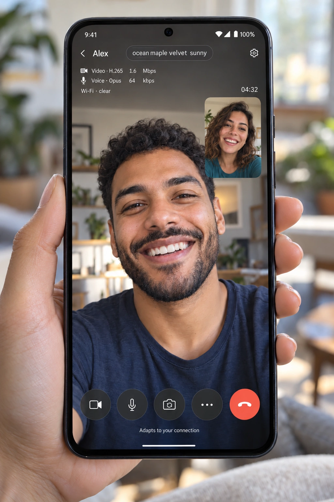
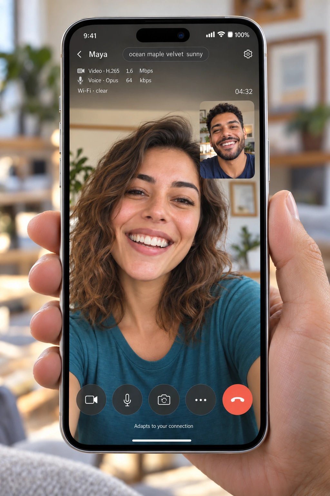

# Documentation images

  
  

## Actual interface captures

The following use WebCaller's shipped HTML/CSS/icons and message renderer, populated by `scripts/release-preview.js` with fictional contacts/messages:

- `desktop-chat.jpg`: desktop light appearance, 1280×820.
- `mobile-home.jpg`: mobile contacts, 390×844.
- `mobile-chat.jpg`: mobile dark chat, 390×844.
- `overview.jpg`: original HTML device-frame composition of the captures, 1600×1100.
- `demo-landscape.svg`: original vector illustration made for this documentation, rendered to a PNG Blob inside the fixture so the real supported image-message renderer displays it. It depicts no real location.

Run `node scripts/preview-release.mjs` and open the printed loopback address in a browser. Use `?view=chat`, `?view=home`, `?view=mobile` and `/overview` with the indicated viewport sizes. The overview needs the first captures saved in this directory. The fixture makes no application API calls and does not enroll phones or enable notifications. It is a development preview, not the production server.

Screenshots demonstrate appearance; example delivery checks/countdowns do not represent a real exchange, measured network quality or a security verification. Device frames are illustrative. Original documentation illustration/layout follows the repository's original-code MIT notice; application/dependency/artwork licenses remain as documented in the project.
